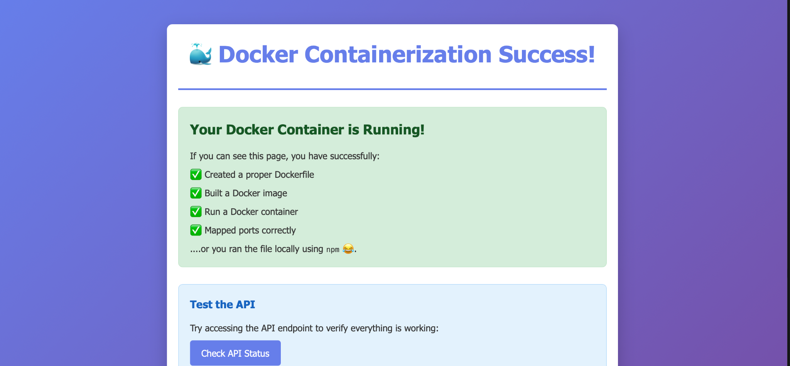
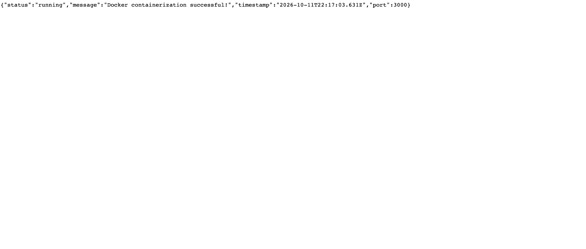

# Assignment #4: Application Containerization

This is a simple Node.js web application designed for learning Docker containerization concepts.

## Application Overview

This application is a basic Express.js web server that:

- Serves a static HTML page at the root (`/`)
- Provides an API status endpoint at `/api/status`
- Includes a health check endpoint at `/health`
- Runs on port 3000 by default

## What's Included

- **app.js**: Main application server file
- **package.json**: Node.js dependencies and project configuration
- **public/index.html**: HTML page that shows Docker is working
- **public/style.css**: Styling for the website
- **Dockerfile**: Instructions for building and running the Docker application
- **screenshots**: Pictures showing the website and API working

## Running Without Docker (for reference only)

If you wanted to run this application without Docker, you could use:

```bash
npm install
npm start
```

## Your Docker Assignment

The goal of this assignment is to run a Node.js application using Docker without changing the original application code.

For this assignment, I:

1. Created a Dockerfile with comments.
2. Built a Docker image.
3. Started a Docker container.
4. Tested the website on port 3000.
5. Tested the API status endpoint.
6. Took screenshots showing everything working.

## Starting the Application

To build the Docker image, run:

```bash
docker build -t my-node-app .
```

To run the Docker container on port 3000, run:

```bash
docker run -d -p 3000:3000 --name my-node-container my-node-app
```

After running the container, open:

Website:
http://localhost:3000

API Status:
http://localhost:3000/api/status

## Docker Container Management

To see running containers:

```bash
docker ps
```

To stop the container:

```bash
docker stop my-node-container
```

To start the container again:

```bash
docker start my-node-container
```

To remove the container after stopping it:

```bash
docker rm my-node-container
```

## Reflection Question

**How does containerization with Docker differ from using virtual machines, and why might a development team choose Docker containers over VMs for deploying applications like the one you just containerized?**

Docker containers and virtual machines are different because Docker containers share the host operating system's kernel, while virtual machines run their own operating systems. Docker containers are smaller and usually start faster. A development team might choose Docker because it makes applications easier to run on different computers. Docker also helps prevent problems with missing software or different versions. This makes it easier for developers to work together and deploy applications.

## Application Requirements for Docker

My Dockerfile:

- Uses Node.js version 16
- Sets the working directory to `/app`
- Copies the package files
- Installs dependencies using `npm install`
- Copies the application files
- Exposes port 3000
- Starts the application using `npm start`

## Verification

I successfully built my Docker image and ran my container.

When I opened http://localhost:3000, the website displayed:

**Docker Containerization Success!**

I also opened http://localhost:3000/api/status.

The API returned a successful response showing:

- Status: running
- Message: Docker containerization successful!
- Port: 3000

This confirmed that my application was running correctly.

## Screenshots

### Screenshot 1: Docker Website Running



### Screenshot 2: API Status Response



## Troubleshooting Tips

- Make sure Docker Desktop is running.
- Check that port 3000 is mapped correctly.
- Make sure all application files are copied into the container.
- Make sure the dependencies are installed.
- Use `docker logs my-node-container` to check for errors.

## File Structure

```text
COMPSVIII-Assignment4/
├── Dockerfile
├── app.js
├── package.json
├── package-lock.json
├── public/
│   ├── index.html
│   └── style.css
├── screenshots/
│   ├── website.png
│   └── api-status.png
└── README.md
```

## Conclusion

This assignment helped me learn how to use Docker to build and run an application. I learned how to create a Dockerfile, build an image, run a container, and test a website and API. Docker makes it easier to run applications on different computers without worrying about missing software.
